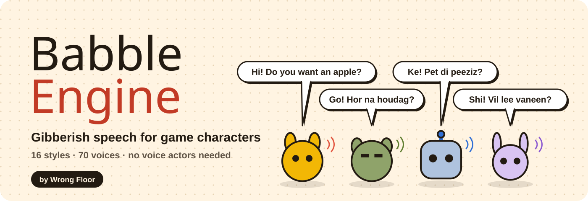
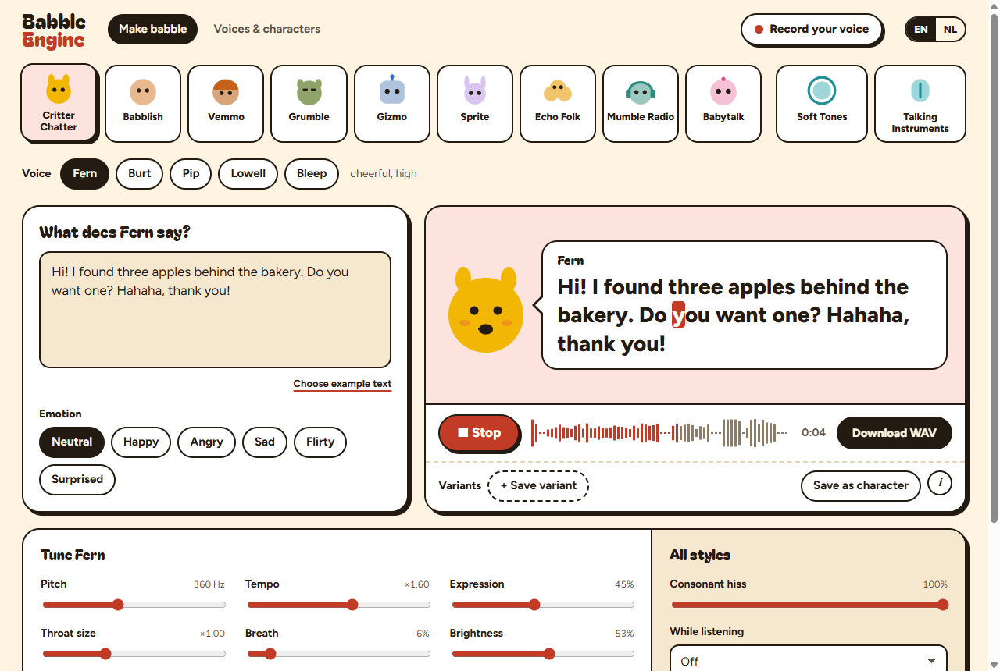
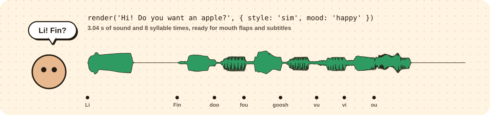
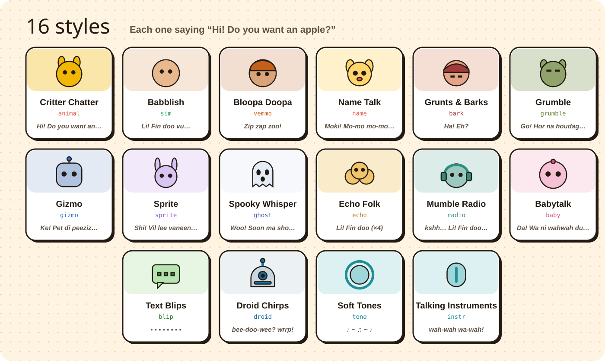

<p align="center">
  <a href="https://babble.wrongfloor.studio/"></a>
</p>

<p align="center">
  <a href="https://babble.wrongfloor.studio/"><b>🎙️ Try the tool</b></a> &nbsp;·&nbsp;
  <a href="#-web-module"><b>🧩 Web module</b></a> &nbsp;·&nbsp;
  <a href="#-styles-and-voices"><b>🐾 Styles</b></a> &nbsp;·&nbsp;
  <a href="#-license"><b>📜 MIT</b></a>
</p>

Your characters want to talk. Your budget doesn't include voice actors. **Babble Engine** turns any line of text into gibberish speech: critter chatter, made-up languages, grumbling trolls, beeping robots, whispering fairies and soft musical tones.

🚫 No voice actors &nbsp; 🚫 No server &nbsp; 🚫 No dependencies &nbsp; ✅ Free, also for commercial games

## 🎙️ The tool

**[babble.wrongfloor.studio](https://babble.wrongfloor.studio/)** runs in your browser. Type a line, pick a style and a voice, set the mood, and download a WAV.

<p align="center"></p>

- 🐹 **16 styles, 70 voices**, from Critter Chatter to retro text blips and a talking kazoo
- 😄 **6 moods**: neutral, happy, angry, sad, flirty, surprised
- 🎛️ **Tune every voice**: pitch, tempo, expression, throat size, breath, brightness
- 🎤 **Record your own voice** and your characters babble with it: a sound no other game has. The basic round is under 2 minutes of reading and works with all 12 voice styles. Optional short rounds add double consonants (bl, kr), word endings (ahp, ohm) and barks, and you can redo any round. Recordings stay in your browser, nothing is uploaded. Export a voice to use it in your own game
- 🧑‍🤝‍🧑 **Save characters** so Grandpa Hank sounds like Grandpa Hank every time
- 💾 **Download WAV**, ready for any engine

## 🧩 Web module

Making a web game? Use the same engine straight from your code. One file, no build step.

```html
<script type="module">
  import { render, play } from 'https://cdn.jsdelivr.net/gh/wrongfloor-dev/babble-engine@1/site/src/babble.mjs';

  const line = render('Hi! Do you want an apple?', { style: 'animal', voice: 'fern', mood: 'happy' });
  document.querySelector('button').onclick = () => play(line);
</script>
```

<p align="center"></p>

`@1` follows the newest 1.x release. Pin an exact version (`@1.0.0`) for a game you ship.

- 📜 **Plain script tag:** load `site/src/engine.js` and use the global `Babble` (`Babble.render(...)`)
- 📦 **Node or a bundler:** `npm i github:wrongfloor-dev/babble-engine`, then `import { render, toWav } from 'babble-engine'`
- 🔷 **TypeScript:** types ship in `site/src/engine.d.ts`

### `render(text, options)`

Returns `{ pcm, sampleRate, duration, syllables, style, voice }`. `pcm` is a mono `Float32Array`, dry (no room).

| Option | Default | |
|---|---|---|
| `style` | `'animal'` | see the styles below |
| `voice` | the style's first voice | |
| `mood` | `'neutral'` | `neutral`, `happy`, `angry`, `sad`, `flirty`, `surprised` |
| `seed` | `1` | 🎲 same text, options and seed give the same sound. Change it for a different take or another made-up language |
| `sampleRate` | `48000` | |
| `pitch`, `speed`, `expression`, `throat`, `breath`, `brightness` | from the voice | override the voice |
| `hiss` | `1` | consonant noise, 0 to 1 |
| `ownVoice`, `steady` | none, `1` | a recorded voice from `loadVoice()`, see below. `steady` 0 follows your recorded pitch, 1 holds each syllable on the melody |
| `name` | the voice's name | Name Talk only: the name the creature keeps saying, like `'Pikachu'` |
| `intent`, `length` | `'tell'`, `'short'` | Bloopa Doopa only: it speaks by intent (`greet`, `ask`, `joy`, `letdown`…) and ignores the text |

👄 `syllables` is a list of `{ time, text }`: the start of every syllable in seconds. Flap a mouth, bounce a sprite or reveal subtitles in sync.

### 🎤 Your own voice in your game

1. Record your voice in the tool, under **Voices & characters**
2. Click **Export** next to it. You get a `.babble-voice.json` file
3. Load it and babble with it in any voice style:

```js
import { render, play, loadVoice } from 'https://cdn.jsdelivr.net/gh/wrongfloor-dev/babble-engine@1/site/src/babble.mjs';

const me = loadVoice(await (await fetch('me.babble-voice.json')).text());
play(render('Welcome to my game!', { style: 'sim', ownVoice: me }));
```

The file holds every recorded sound as 16-bit audio in JSON, including the extra rounds, so other engines can read it too.

### More

- ▶️ `play(result, { room = true, context })`: browser only. Plays the line with the style's room, like the tool. Returns `{ stop(), ended, context }`
- 💾 `toWav(result)`: a 16-bit mono WAV as an `ArrayBuffer`, dry
- 📋 `styles()`: every style with its voices, moods and intents
- 🎤 `loadVoice(file)`: a `.babble-voice.json` from the tool, as text or parsed JSON

## 🐾 Styles and voices

<p align="center"></p>

| | Style | Name | Voices |
|---|---|---|---|
| 🐹 | `animal` | Critter Chatter | `fern`, `burt`, `pip`, `lowell`, `bleep` |
| 🗣️ | `sim` | Babblish | `lottie`, `ben`, `kiki`, `hank`, `whisper`, `bubs` |
| 🎪 | `vemmo` | Bloopa Doopa | `jesse`, `bram`, `mila` |
| 🐾 | `name` | Name Talk | `moki`, `grumbo`, `zee`, `lulu`, `bonk` |
| 🗡️ | `bark` | Grunts & Barks | `hero`, `heroine`, `elder`, `kid`, `brute` |
| 👹 | `grumble` | Grumble | `grok`, `moss`, `burly` |
| 🤖 | `gizmo` | Gizmo | `bolt`, `cog`, `unit9` |
| 🧚 | `sprite` | Sprite | `fae`, `wisp`, `glimmer` |
| 👻 | `ghost` | Spooky Whisper | `whisper`, `wail`, `hollow` |
| 🏘️ | `echo` | Echo Folk | `village`, `crowd`, `kids` |
| 📻 | `radio` | Mumble Radio | `dispatch`, `pilot`, `scout` |
| 👶 | `baby` | Babytalk | `tot`, `bubba`, `mini` |
| 🎐 | `tone` | Soft Tones | `clouds`, `softbubble`, `rain`, `breeze`, `hum`, `purr`, `wood`, `droplet`, `kalimba`, `felt`, `bubble`, `glass` |
| 💬 | `blip` | Text Blips | `pixel`, `tiny`, `boss`, `soft`, `typewriter` |
| 🛰️ | `droid` | Droid Chirps | `beebo`, `rollo`, `zapp`, `mini` |
| 🎺 | `instr` | Talking Instruments | `horn`, `trombone`, `choir`, `kazoo` |

## 🗺️ What's next

- 🤖 A Godot 4 addon with a `BabbleSpeaker` node and a signal per syllable

## 🛠️ Repository

- `site/`: the tool as published on babble.wrongfloor.studio. Plain HTML and JavaScript, no build step. `site/src/engine.js` is the engine, shared by the tool and the web module
- `tests/`: `node tests/check.mjs` (copy, links, headers) and `node tests/engine.mjs` (every voice renders, seeds repeat, WAV is valid). Or just `npm test`
- `docs/art/`: the pictures in this README

## 📜 License

Code: **MIT**, see [`LICENSE`](LICENSE). Audio you make with Babble Engine is **yours to use, also commercially**. No credit needed, but a mention is always welcome 💛

<p align="center">Made with 🐹 by <a href="https://wrongfloor.studio"><b>Wrong Floor</b></a></p>
